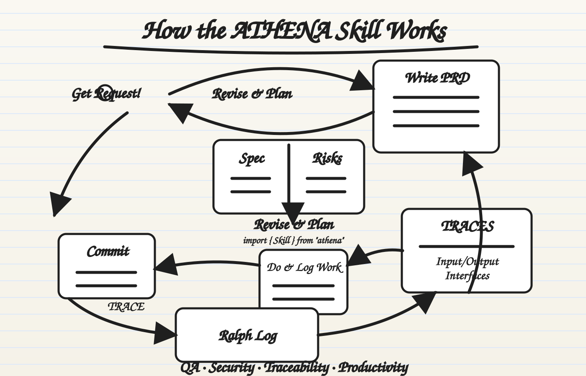
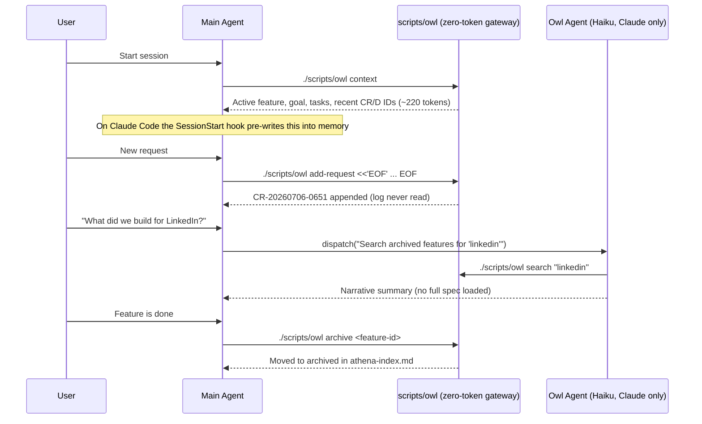
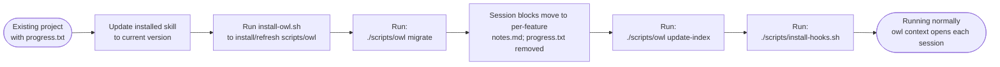
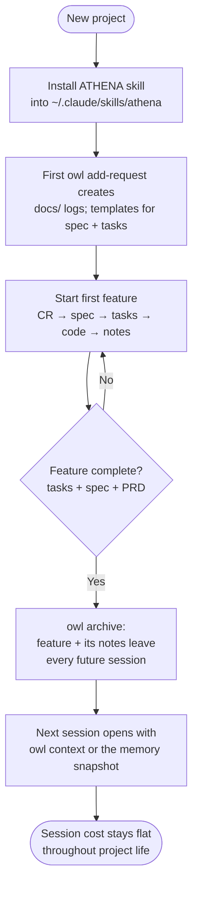

# ATHENA Framework



ATHENA is an agent-agnostic delivery framework for PRD-driven, traceable software execution.

## What ATHENA Does

ATHENA creates a **complete audit trail from customer request to shipped code**:

- **Captures customer requests verbatim** in `docs/requests.md` (CR-... IDs)
- **Documents design decisions** in `docs/decisions.md` (D-... IDs)
- **Maintains a living PRD** in `docs/PRD.md` with full traceability
- **Specs features** in `docs/specs/<FEATURE_ID>/spec.md` with functional requirements (FR-...)
- **Lists tasks** in `docs/specs/<FEATURE_ID>/tasks.md` linked to requirements (Implements: FR-...)
- **Records execution evidence** in `docs/specs/<FEATURE_ID>/notes.md` (commands, outcomes, commit hashes)
- **Creates traceable Git commits** referencing CR/D/FEATURE_ID/T-... IDs
- **Enables auditing** via `docs/TRACEABILITY.md` to follow any request through to code

Since v2.1.0 the audit trail is **script-gated**: agents never read the logs. All access goes through the deterministic `./scripts/owl` CLI — `owl context` opens a session in ~220 tokens instead of reading five files, `owl add-request`/`add-decision`/`add-note` append without reading, and `owl show`/`owl why` retrieve exactly one entry or one traceability chain. Measured on this repository, identical feature requests run end-to-end by cold agents cost **63% fewer tokens on Claude Code** and **13.5% fewer on Codex** than the pre-v2.1 layout, with the same audit trail produced.

---

## Installation

Choose the path that matches your environment:

| Environment | What to install | Stop after |
|---|---|---|
| Codex | Install the packaged `athena` skill | Step 1 |
| Claude Code | Install the packaged `athena` skill, then install Owl of Athena for archive management | Step 2 |

The **ATHENA skill** is the core loop. **Owl of Athena** is optional for Codex and only has a full documented setup flow for Claude Code in this README.

### Step 1 — Install the ATHENA Skill

#### Codex quick start

```bash
python3 "$CODEX_HOME/skills/.system/skill-installer/scripts/install-skill-from-github.py" \
  --repo taylorparsons/athena-skill \
  --path skills/athena \
  --name athena
```

This installs only the packaged `skills/athena` target and avoids copying the whole repository.

After install:
- Restart Codex so it can discover the new skill.
- Verify `$CODEX_HOME/skills/athena/SKILL.md` exists.
- Keep `~/.codex/AGENTS.md` minimal — trigger + stop-gates only (the loop lives in SKILL.md). Recommended block: see `adapters/codex/SKILL.md`.
- Codex users can stop here. Owl-the-agent is Claude-specific; on Codex the same operations are plain `./scripts/owl` commands.

#### Claude Code quick start

In an active Claude Code session, paste this prompt:

```
Install the athena skill from https://github.com/taylorparsons/athena-skill — copy the entire skills/athena/ directory into ~/.claude/skills/athena/
```

Claude will write `~/.claude/skills/athena/` including `SKILL.md`, `references/`, `templates/`, `scripts/`, `agents/`, and `assets/`.

After install:
- Verify `~/.claude/skills/athena/SKILL.md` exists.
- Or run `/skills` in Claude Code and confirm `athena` is listed.

#### Claude Code plugin

This repository is also a Claude Code plugin named `athena` (manifest: `.claude-plugin/plugin.json`). To install it from this repository's marketplace (`.claude-plugin/marketplace.json`):

```
/plugin install athena --marketplace taylorparsons/athena-skill
```

Requires Claude Code 2.1.275 or later.

**New in v2.3.0:** the log and spec trimming commands above, and this plugin packaging. See `CHANGELOG.md`.

The plugin adds the `athena` skill and the Owl of Athena sub-agent (`agents/owl-of-athena.md`). It does not add Owl's hooks (Step 2b), and it does not create the ATHENA docs or `./scripts/owl` in your project. Set those up per project with Step 3 or Option C below.

---

### Step 2 — Install Owl of Athena (Claude Code only)

Skip this entire step if you use Codex and only want the ATHENA skill.

Owl requires three things: the agent file, the global hooks, and the git hooks on each project.

#### 2a. Copy the agent file

From a full `athena-skill` repository checkout, run:

```bash
mkdir -p ~/.claude/agents
cp .claude/agents/owl-of-athena.md ~/.claude/agents/owl-of-athena.md
```

This makes Owl available as a sub-agent in every Claude Code session.

#### 2b. Add hooks to `~/.claude/settings.json`

Open `~/.claude/settings.json` and merge in the `hooks` block below. If you already have a `hooks` key, add `SessionStart` and `Stop` into the existing object — do not replace the whole file.

```json
{
  "hooks": {
    "SessionStart": [
      {
        "matcher": "",
        "hooks": [
          {
            "type": "command",
            "command": "cd \"$(git rev-parse --show-toplevel)\" && ./scripts/owl prune-done | jq -r '.message // .' && ./scripts/owl update-index | jq -r '.message // .' && ./scripts/owl write-memory | jq -r '.message // .'; true"
          }
        ]
      }
    ],
    "Stop": [
      {
        "matcher": "",
        "hooks": [
          {
            "type": "command",
            "command": "cd \"$(git rev-parse --show-toplevel)\" && ./scripts/owl prune-done | jq -r '.message // .' && ./scripts/owl update-index | jq -r '.message // .'; true"
          }
        ]
      }
    ]
  }
}
```

Both hooks are conditional — they check for `scripts/owl` before running and are safe to install globally. They only activate in repos where Owl is present.

**`scripts/owl` requirement:** Each ATHENA project must have a `scripts/owl` wrapper. It routes to `owl.py`, the KB gateway:
- `context` — compact session-open block (active feature, goal, task state, recent CR/D IDs, latest request)
- `add-request` / `add-decision` / `add-note` — append audit entries with generated IDs, no reads
- `show <ID>` / `why <FR-ID>` — retrieve one entry or one full traceability chain
- `update-index` — regenerates `athena-index.md` from current spec status
- `write-memory` — writes the active-context snapshot into Claude Code auto-memory
- `migrate` — one-time conversion of legacy `progress.txt` repos to per-feature `notes.md`
- `prune-prd` — archives PRD link ceremony and closed backlog lines
- `prune-done` — legacy no-op on migrated repos

The wrapper is **runtime-agnostic** — it detects owl.py in this priority order:
1. `scripts/owl.py` in the project (Codex pattern — bundled locally)
2. `~/.claude/skills/athena/scripts/owl.py` (Claude Code installed skill)
3. `$CODEX_HOME/skills/athena/scripts/owl.py` (Codex installed skill)
4. Bash fallback (`write-memory` only)

The installer is root repo setup tooling, not packaged skill runtime. It requires access to a full `athena-skill` checkout where root `scripts/install-owl.sh` exists. When setting up another project, run that checkout's script from the target ATHENA project root.

Install it in a target ATHENA project from that project's root:
```bash
bash /path/to/athena-skill/scripts/install-owl.sh
```

> **Already installed?** If you set up Owl before April 2026, your `SessionStart` hook may use the old `type: "agent"` format which is not supported and will cause a hook error on session start. Run the patch script to fix it:
> ```bash
> python3 scripts/patch-claude-settings.py
> ```

**What each hook does:**

| Hook | When | What |
|---|---|---|
| `SessionStart` | Project opens | Shell command runs `prune-done` + `update-index` + `write-memory` before Athena loads |
| `Stop` | Session ends | Same cleanup as a belt-and-suspenders pass |

#### 2d. Add Owl to `~/.claude/CLAUDE.md`

If you have a `~/.claude/CLAUDE.md` with an Available Skills section, add the following entry after the `athena` entry. This scopes Owl to mid-session dispatches — the `SessionStart` hook handles the pre-session run automatically.

```markdown
### owl-of-athena
**Path:** `.claude/agents/owl-of-athena.md` (sub-agent, dispatched via Agent tool)
**Trigger:** Dispatch mid-session when: a feature is fully done (archive it), the user asks about archived features, or athena-index.md appears stale. Never load archived specs directly — use Owl. Note: `prune-done`, `update-index`, and `write-memory` run automatically via the `SessionStart` shell hook before Athena loads — do not dispatch Owl for these at session start.
```

> **Already installed?** The patch script handles both `settings.json` and `CLAUDE.md` in one pass:
> ```bash
> python3 scripts/patch-claude-settings.py
> ```

#### 2c. Install git hooks on each ATHENA project

Run this once per project, from the project root:

```bash
./scripts/install-hooks.sh
```

This installs:
- `pre-commit` — blocks commits if `athena-index.md` is out of sync with `docs/specs/`
- `post-commit` — regenerates `athena-index.md` when a commit signals feature completion

---

### Step 3 — Bootstrap an existing project (first time only)

If your project already has ATHENA docs but no `athena-index.md`, you have two options:

**Fast path — paste this prompt into Claude Code:**

```
Bootstrap Owl of Athena in this project. Run ./scripts/owl update-index to generate docs/athena-index.md, run ./scripts/install-hooks.sh to install git hooks, run ./scripts/owl migrate if docs/progress.txt exists, then commit the results.
```

**Manual path:**

```bash
python3 scripts/owl.py update-index
git add docs/athena-index.md && git commit -m "feat: add athena-index.md for Owl of Athena"
```

New projects get `athena-index.md` automatically when Claude scaffolds the docs structure.

---

### Option C: Bootstrap ATHENA docs in a new project

To set up the full ATHENA docs structure in an existing project (`docs/requests.md`, `docs/decisions.md`, `docs/PRD.md`, `docs/specs/`, `docs/athena-index.md`, etc.), open Claude Code in that project and paste:

```
Setup ATHENA docs in this project from https://github.com/taylorparsons/athena-skill
```

Claude will create the full scaffold including `athena-index.md`. Then run `./scripts/install-hooks.sh` to activate the git hooks.

---

## Owl of Athena (Claude Code)

Owl has two halves. **Owl-the-script** (`scripts/owl.py`) is the deterministic KB gateway every session uses — it costs zero tokens. **Owl-the-agent** (a Haiku sub-agent, Claude Code only) is dispatched only for judgment calls: narrative summaries of archived features, history questions that need synthesis.

**What the Owl gateway does:**
- Opens sessions: `owl context` prints the active feature, goal, task state, recent CR/D IDs, and the latest request — replacing full reads of five docs files
- Takes appends: requests, decisions, and session notes are written through the script with generated IDs, never by editing the logs
- Answers queries: `owl show <ID>` for one entry, `owl why <FR-ID>` for a requirement's full chain (sources → tasks → commits)
- Maintains derived state: `athena-index.md`, the Claude Code memory snapshot, and PRD pruning
- Keeps logs lean (v2.3.0): `owl archive-logs` moves old request/decision entries to `docs/audit/`, `owl archive-specs` condenses Done specs (`owl restore-spec <id>` undoes it), and `owl trim` runs both (try `--dry-run` first). `owl show <ID>` still finds archived entries. `owl archive` also condenses the spec; `--keep-spec` opts out.

**Token impact** (measured 2026-07-05 on this repository — identical feature request, cold agents, full loop end to end, v2.0 layout vs v2.1):

| Harness | v2.0 layout | v2.1 layout | Reduction |
|---|---:|---:|---:|
| Claude Code (Fable) | 161,349 tokens | 59,942 tokens | **−63%** |
| Codex (gpt-5.5, high reasoning) | 225,195 tokens | 194,730 tokens | **−13.5%** |

Fixed session-open overhead (what loads before any real work) dropped ~94%: ~26,700–32,600 tokens → ~1,450–1,660. The harness difference is amplification, not effectiveness — Claude's accounting re-carries context every turn, so removing ~28K of early reads compounds; Codex surfaces the overhead roughly once, and its high-reasoning thinking tokens dominate both arms equally. Savings grow with project age: the old layout re-read append-only logs that only grow; the new layout's cost is flat.

### How a Session Works



### When the Main Agent Dispatches to Owl

The main agent uses the Agent tool to delegate — it does not load archived specs directly.

| Situation | Dispatch prompt |
|---|---|
| User asks about a closed feature | `"Retrieve summary for <feature-id>"` |
| User searches history | `"Search archived features for '<keyword>'"` |
| Feature is fully done (tasks + spec + PRD) | `"Archive feature <feature-id>"` |
| athena-index.md is out of sync | `"Run update-index"` |

### When is a Feature Done?

Three checks must agree before archiving: `tasks.md` has nothing under NEXT or IN PROGRESS (ground truth for completion), `spec.md` says `Status: Done` (formally closed), and the PRD shows it shipped (not just done in isolation). Then `owl archive <id>` moves it in the index — and because session notes live inside the feature's own spec directory, archiving removes its entire history from every future session at zero cost.

### Session Notes: Per-Feature, Not Global

Execution evidence lives in `docs/specs/<FEATURE_ID>/notes.md`, appended via `owl add-note` (timestamped blocks with agent, model, skills, goal, commands run, and commit hashes). There is no global execution log to grow or prune — the legacy `docs/progress.txt` is retired. Repos still on it keep working (every owl command falls back automatically) until you run the one-time, lossless `./scripts/owl migrate`.

---

## Upgrading Existing ATHENA Projects

If your project was using ATHENA before v2.1.0, run this once after updating the installed skill:



**Fast path — paste this into Claude Code:**

```
Migrate this project to the current Athena version: from this project's root, run bash /path/to/athena-skill/scripts/install-owl.sh, then ./scripts/owl migrate, ./scripts/owl update-index, and commit the results.
```

**Manual path:**

1. Update the installed skill (`~/.claude/skills/athena` and/or `$CODEX_HOME/skills/athena`) to the current version.
2. From the project root, run `bash /path/to/athena-skill/scripts/install-owl.sh` using a full `athena-skill` checkout. This installs `scripts/owl` as a delegation wrapper that routes all commands to the authoritative `owl.py` in the installed skill.
3. Run `./scripts/owl migrate` once. Each `progress.txt` session block moves into the matching feature's `notes.md`; blocks that can't be attributed go to `docs/audit/progress-legacy.txt`; `progress.txt` is deleted. The command is idempotent and lossless.
4. Run `./scripts/owl update-index`, then `./scripts/install-hooks.sh`.
5. Commit `scripts/owl`, `docs/athena-index.md`, the new `notes.md` files, and the `progress.txt` deletion.

Unmigrated repos keep working — every owl command falls back to `progress.txt` until you migrate.

**What does not change:** `docs/requests.md`, `docs/decisions.md`, `docs/PRD.md`, and all existing spec files are untouched. The traceability audit trail is preserved exactly as-is.


---

## New Projects Starting with ATHENA

New projects get Owl automatically — no migration step needed.



**Key difference from existing projects:** No legacy `progress.txt` exists to migrate. Session history lives in each feature's `notes.md` from day one, and archiving a feature removes its history from the loop entirely.

## Fleet Management

### `sweep-projects.py` — Weekly token-optimization sweep

Scans all projects for token-waste patterns and optionally auto-fixes safe issues.

```bash
# Report only
python3 ~/.claude/skills/athena/scripts/sweep-projects.py --dry-run

# Auto-fix safe issues (prune-done, update-index)
python3 ~/.claude/skills/athena/scripts/sweep-projects.py --fix
```

**What it checks:**
- `athena-index.md` missing or stale (> 7 days)
- Legacy `progress.txt` still present (recommend `./scripts/owl migrate`)
- Done specs not yet archived in `athena-index.md`
- Files in `docs/` > 100 KB or binary assets
- `requests.md`/`decisions.md` > 150 lines without an `## Archive` section (informational — the logs are script-gated and never read in full)

Output is logged to `~/.claude/logs/athena-sweep.log`. Schedule weekly via crontab:

```
57 1 * * 1 python3 ~/.claude/skills/athena/scripts/sweep-projects.py --fix >> ~/.claude/logs/athena-sweep.log 2>&1
```

---

## Install Target

- `skills/athena/`: canonical full `athena` skill for Codex/Claude Code
- Contains exactly one `SKILL.md` with required frontmatter (`name`, `description`)

## Quick Start (5 minutes)

1. **Review the loop**: Read `skills/athena/SKILL.md` — the 5-step ATHENA loop (86 lines)
2. **Open a session**: Run `./scripts/owl context` (or let the Claude Code memory snapshot do it)
3. **Capture your first request**: `./scripts/owl add-request <<'EOF' ... EOF` — returns the CR-... ID
4. **Create a feature spec**: Copy `templates/spec.md` to `docs/specs/<FEATURE_ID>/spec.md`; same for `tasks.md`
5. **Record decisions**: `./scripts/owl add-decision --cr <CR-ID>` when you interpret the request
6. **Execute and close**: One task at a time; `./scripts/owl add-note --feature <FEATURE_ID>` for session evidence; commit via `scripts/commit_with_traceability.py`

## Repository Layout

- `skills/athena/`: installable `athena` package
- `core/athena-framework.md`: background methodology notes (the operative loop is `skills/athena/SKILL.md`)
- `adapters/`: framework adapter source materials
- `templates/`: traceability templates
- `scripts/`: helper automation (`owl.py`, `install-owl.sh`, `install-hooks.sh`, `sweep-projects.py`, `commit_with_traceability.py`, `bootstrap_git_audit.py`, `print_resume_prompt.py`, `tests/`)
- `VERSION`: source-of-truth framework version (SemVer)
- `docs/`: this repo's own ATHENA artifacts and examples (walkthrough examples in `docs/examples/`)

## Key Files & What They Do

| File | Purpose |
|------|---------|
| `skills/athena/SKILL.md` | The operative ATHENA loop (86 lines) — installed into `~/.claude/skills/athena` / `$CODEX_HOME/skills/athena` |
| `skills/athena/references/` | Setup/migration, commit ceremony, and recovery procedures — loaded only when needed |
| `docs/TRACEABILITY.md` | Entry point: navigate from request to code |
| `docs/requests.md` | Customer inputs (append-only log) |
| `docs/decisions.md` | Design decisions (append-only log) |
| `docs/PRD.md` | Living requirements document |
| `docs/specs/*/spec.md` | Feature specifications with acceptance criteria |
| `docs/specs/*/tasks.md` | Implementation tasks (Implements: FR-...) |
| `docs/specs/*/notes.md` | Per-feature session evidence (commands, outcomes, commit hashes) — appended via `owl add-note` |
| `docs/athena-index.md` | Generated feature index — maintained by `owl update-index`, never edited or read directly |
| `.claude/agents/owl-of-athena.md` | Owl sub-agent definition (Claude Code) — copy to `~/.claude/agents/` |
| `.claude/settings.json` | SessionStart + Stop hooks — run the owl gateway before Athena loads and on exit |
| `scripts/owl.py` | The KB gateway: context, add-request/add-decision/add-note, show, why, archive, retrieve, search, update-index, migrate, prune-prd, write-memory |
| `scripts/install-owl.sh` | Installs `scripts/owl` delegation wrapper into any Athena project |
| `scripts/install-hooks.sh` | Installs pre-commit and post-commit git hooks |
| `scripts/sweep-projects.py` | Weekly token-optimization sweeper — flags large files, stale index, unarchived specs across all projects |
| `scripts/tests/` | Unit tests for the owl gateway (`python3 -m unittest discover -s scripts/tests`) |
| `templates/` | Ready-to-use templates for specs, tasks, notes, requests, decisions, traceability |
| `scripts/` | Helper utilities (`commit_with_traceability.py`, `bootstrap_git_audit.py`, etc.) |
| `adapters/claude/` | Claude-specific guidance (`COMMANDS.md`, `CLAUDE_PROMPT.md`) |
| `adapters/codex/` | Codex skill adapter |

## Non-Negotiable Rules

1. **Capture verbatim**: Record customer requests exactly as stated before changing anything.
2. **Append-only logs**: Never delete or edit `docs/requests.md` or `docs/decisions.md` entries.
3. **Full traceability**: Link sources (CR/D) to requirements (FR) to tasks (T).
4. **Single focus**: Only one task `IN PROGRESS` at a time.
5. **Evidence required**: Every task needs test/check results.
6. **Git integration**: Commit messages reference CR/D/FEATURE_ID/T-... IDs.
7. **Never auto-push**: Only push to remote when explicitly requested.

## Validation

Run install-target validation locally:

```bash
python3 scripts/validate_install_targets.py
```

This checks:
- each declared install target exists,
- each target has exactly one `SKILL.md`,
- frontmatter includes required `name` and `description`.

## Versioning

- Version source of truth: `VERSION`
- Scheme: Semantic Versioning (`MAJOR.MINOR.PATCH`)
- Git tag format: `v<MAJOR>.<MINOR>.<PATCH>`

## Help & Resources

- **Examples**: `docs/examples/01-cr-to-task-walkthrough.md` (step-by-step example)
- **Claude Adapter**: `adapters/claude/CLAUDE_PROMPT.md` and `adapters/claude/COMMANDS.md`
- **Codex Skill**: `adapters/codex/SKILL.md` (Codex skill definition)

## Publishing

- GitHub as source of truth (tags/releases)
- LinkedIn for launch/adoption examples
- `publishing/launch-checklist.md`

## Requirements

- Claude Code 2.1.275 or later for the plugin install; the Codex install needs only the skill files.
- `python3` to run `scripts/owl.py` and the other ATHENA scripts.
- `git` for the commit-traceability scripts and git hooks.

## License

MIT. See [LICENSE](LICENSE).
